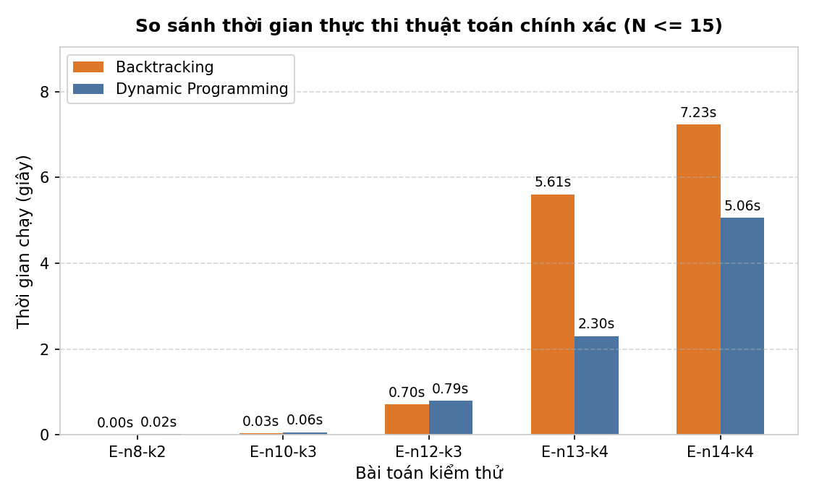
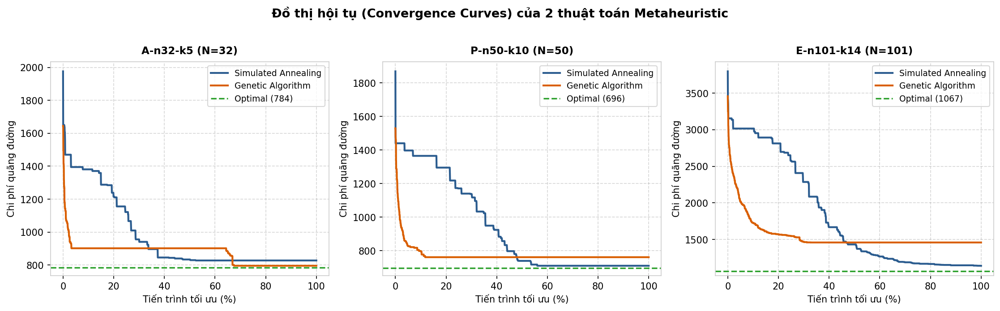
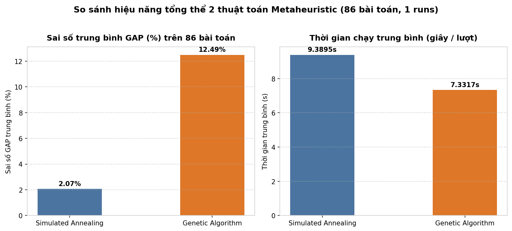

# CVRP Benchmark Summary Report

> **Thời gian tạo**: 2026-11-15 10:17:59  
> **Quy tắc phân loại**: Ngưỡng $N = 15$  
> - $N \le 15$: Chỉ chạy 2 thuật toán chính xác (`backtracking`, `dynamic_programming`), không áp `time_limit` để giải tới nghiệm tối ưu chính xác.  
> - $N > 15$: Chỉ chạy 2 thuật toán metaheuristic (`simulated_annealing`, `genetic_algorithm`), số lần chạy $runs = 1$.  

---

## 1. Cấu hình tham số & siêu tham số

| Thuật toán | Tham số / Siêu tham số | Mô tả cài đặt cơ bản |
| :--- | :--- | :--- |
| **Backtracking** ($N \le 15$) | `time_limit=None`, `max_customers=None` | Quay lui cơ bản kết hợp tỉa nhánh cận dưới `min_out` và chặn đối xứng đầu tuyến |
| **Dynamic Programming** ($N \le 15$) | `max_customers=None` | Quy hoạch động bitmask đệ quy có nhớ `memo[(mask, last_u, rem_cap)]` |
| **Simulated Annealing** ($N > 15$) | `t_init=200.0`, `t_min=0.05`, `cooling_rate=0.995`, `iters_per_temp=350` | Khởi tạo hoán vị ngẫu nhiên, 3 toán tử lân cận và phạt sai số xe $K$ |
| **Genetic Algorithm** ($N > 15$) | `pop_size=80`, `generations=3500`, `crossover_rate=0.75`, `mutation_rate=0.5`, `tournament=5`, `elite=3` | Quần thể ngẫu nhiên, lai ghép OX, đột biến đảo đoạn, Tournament và phạt sai số xe $K$ |

---

## 2. Kết quả thuật toán chính xác (N <= 15)

| testcase | n | cap | vehicle | optimal | algor | time |
| :--- | :---: | :---: | :---: | :---: | :--- | :---: |
| `E-n10-k3` | 10 | 3000 | 3 | 272 | **backtracking** | 0.0333 s |
| `E-n10-k3` | 10 | 3000 | 3 | 272 | **dynamic_programming** | 0.0566 s |
| `E-n12-k3` | 12 | 3500 | 3 | 272 | **backtracking** | 0.7019 s |
| `E-n12-k3` | 12 | 3500 | 3 | 272 | **dynamic_programming** | 0.7922 s |
| `E-n13-k4` | 13 | 6000 | 4 | 247 | **backtracking** | 5.6091 s |
| `E-n13-k4` | 13 | 6000 | 4 | 247 | **dynamic_programming** | 2.3035 s |
| `E-n14-k4` | 14 | 3500 | 4 | 326 | **backtracking** | 7.2323 s |
| `E-n14-k4` | 14 | 3500 | 4 | 326 | **dynamic_programming** | 5.0589 s |
| `E-n8-k2` | 8 | 4000 | 2 | 208 | **backtracking** | 0.0000 s |
| `E-n8-k2` | 8 | 4000 | 2 | 208 | **dynamic_programming** | 0.0165 s |

### Biểu đồ so sánh thời gian thuật toán chính xác

---

## 3. Báo cáo tổng hợp thuật toán Metaheuristic (N > 15, 1 runs trung bình)

### Bảng tổng kết trung bình (86 bài toán)

| Thuật toán | Số bài toán | Số runs | Thời gian TB (`avg_time`) | Sai số TB (`avg_gap`) |
| :--- | :---: | :---: | :---: | :---: |
| **Simulated Annealing (SA)** | 86 | 1 | 9.3895 s | **+2.07%** |
| **Genetic Algorithm (GA)** | 86 | 1 | 7.3317 s | **+12.49%** |

### Một số bài toán tiêu biểu đại diện

| testcase | n | cap | vehicle | optimal | algor | runs | avg_time | avg_gap |
| :--- | :---: | :---: | :---: | :---: | :--- | :---: | :---: | :---: |
| `P-n16-k8` | 16 | 35 | 8 | 450 | **simulated_annealing** | 1 | 5.0167 s | **+0.00%** |
| `P-n16-k8` | 16 | 35 | 8 | 450 | **genetic_algorithm** | 1 | 4.3587 s | **+0.00%** |
| `A-n32-k5` | 32 | 100 | 5 | 784 | **simulated_annealing** | 1 | 5.1685 s | **+5.61%** |
| `A-n32-k5` | 32 | 100 | 5 | 784 | **genetic_algorithm** | 1 | 4.5326 s | **+1.53%** |
| `A-n45-k6` | 45 | 100 | 6 | 944 | **simulated_annealing** | 1 | 6.9211 s | **+3.92%** |
| `A-n45-k6` | 45 | 100 | 6 | 944 | **genetic_algorithm** | 1 | 5.9796 s | **+25.00%** |
| `A-n60-k9` | 60 | 100 | 9 | 1354 | **simulated_annealing** | 1 | 9.1556 s | **+4.65%** |
| `A-n60-k9` | 60 | 100 | 9 | 1354 | **genetic_algorithm** | 1 | 6.8644 s | **+21.64%** |
| `B-n35-k5` | 35 | 100 | 5 | 955 | **simulated_annealing** | 1 | 12.6947 s | **+0.00%** |
| `B-n35-k5` | 35 | 100 | 5 | 955 | **genetic_algorithm** | 1 | 10.2191 s | **+9.01%** |
| `B-n50-k7` | 50 | 100 | 7 | 741 | **simulated_annealing** | 1 | 7.9527 s | **+0.81%** |
| `B-n50-k7` | 50 | 100 | 7 | 741 | **genetic_algorithm** | 1 | 5.9578 s | **+10.66%** |
| `P-n50-k10` | 50 | 100 | 10 | 696 | **simulated_annealing** | 1 | 8.3086 s | **+2.01%** |
| `P-n50-k10` | 50 | 100 | 10 | 696 | **genetic_algorithm** | 1 | 6.8734 s | **+9.34%** |
| `P-n76-k5` | 76 | 280 | 5 | 627 | **simulated_annealing** | 1 | 10.0069 s | **+2.71%** |
| `P-n76-k5` | 76 | 280 | 5 | 627 | **genetic_algorithm** | 1 | 7.8159 s | **+18.82%** |

*(Dữ liệu chi tiết toàn bộ 86 bài toán được lưu trữ tại `metaheuristic_results.csv`)*

---

## 4. Biểu đồ trực quan

### Đồ thị hội tụ (Convergence Curves)

### So sánh hiệu năng tổng thể Metaheuristic (SA vs GA)
